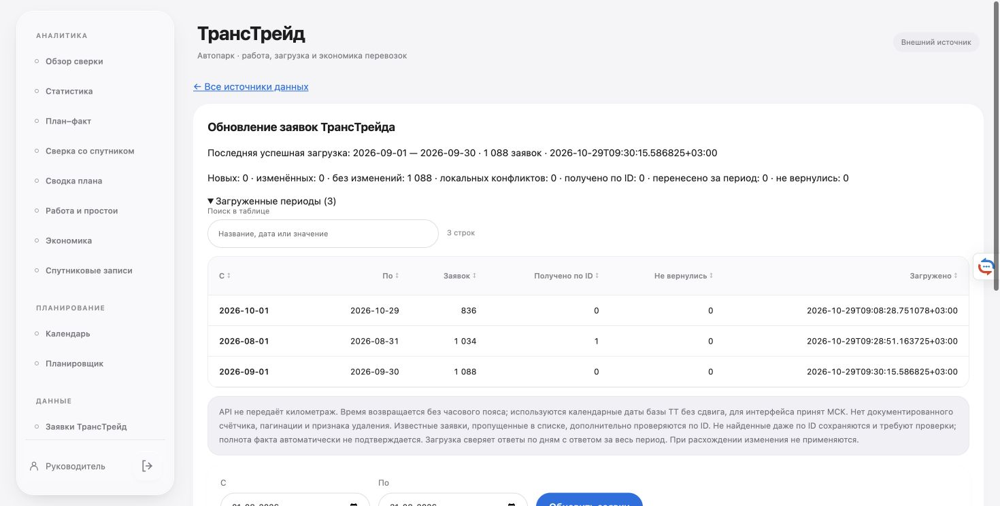

# Повтор загрузки ТрансТрейда — 29.10.2026

## Результат

- Сентябрь, 01–30.09.2026: 1088 заявок, все добавлены. Повтор из рабочего Chrome через кнопку: 0 новых, 0 изменённых, 1088 без изменений, 0 конфликтов и пропусков.
- Август: 1033 строки списочной выдачи + 1 восстановленная по ID = 1034. Обновлена только существующая 51824, 1033 без изменений, новых записей нет.
- Октябрь, 01–29.10: прежние 836 записей сохранены.
- Итог: 2958 активных записей, 2958 уникальных ID, все имеют текущую версию API. Совпадение дневной и месячной выдачи проверено, но не доказывает полноту базы поставщика.

## Почему не загружался сентябрь

DNS/TCP работали, но TLS не завершался через текущий VPN-маршрут utun6 к адресу API. Тот же HTTPS-адрес через физический интерфейс en0 вернул HTTP 200 (TLS около 0,20 с). Ошибка возникала до обработки ключа и дат запроса.

Добавлена отдельная настройка `data/transtrade-network.json` (0600), значение `{"interface":"en0"}`. Requests-адаптер привязывает только соединения к `https://tt-ok.ru/` через macOS IP_BOUND_IF (25). Системные маршруты/VPN не менялись, проверка сертификата включена, редиректы запрещены. При отсутствии настройки используется обычное соединение; при недоступном заданном интерфейсе обновление останавливается с понятной ошибкой. Привязка интерфейса поддержана только на macOS.

## Почему пропускалась 51824

При одинаковом доступе и методе GetOrders воспроизводится различие:

| Параметры | Результат |
|---|---|
| OrderId=51824 | Одна заявка 51824 |
| FromOrderId=51820, ToOrderId=51830 | Десять соседних заявок, 51824 отсутствует |
| Дневные запросы августа и запрос за весь август | Согласованные 1033 строки, 51824 отсутствует |

Прямой ответ: начало 01.08.2026 06:45, окончание 15:35, выручка 17755, выплата 5000, Е191МО797. Статус пуст, подтверждения удаления или отмены нет. Дата и суммы совпадают с Excel. Внутренняя причина пропуска в списках API не раскрыта; утверждать удаление, архив или отсутствие прав нельзя. Официальная документация описывает точечный поиск: https://tt-ok.ru/data/api_doc/ . Приватные доказательства сохранены в `data/tt-investigation-id51824.json` и `data/tt-investigation-range51820-51830.json` (0600).

После сравнения дневной/месячной выдачи интеграция запрашивает известные локальные пропуски по OrderId (не более 100). Неверный ID или ошибка прерывают применение всего периода. Найденная запись обновляется без дубля, сохраняет категорию и прежний снимок; ненайденная остаётся с предупреждением. Перенос даты обновляет ту же запись и снимает подтверждения полноты затронутых периодов. Ручные изменения защищены прежней политикой конфликтов. Строки, восстановленные по ID, отмечаются в таблице и проверке качества. Если такая строка позже вернулась в список, отметка снимается.

Неизвестные локальной базе заявки, которые поставщик скрывает и в дневной, и в месячной выдаче, автоматически обнаружить этим способом нельзя.

## Проверка сохранности и интерфейса

Перед работой создана SQLite-копия `data/before-tt-retry-20261029-092140.sqlite`. `integrity_check=ok`. Все существовавшие до повтора записи вне заявок совпали по всем столбцам; удалений нет. За время работы обнаружен один новый план, которого нет в копии; этот процесс планов не создавал и его не изменял. Snapshot, 114 тарифов, одна учётная запись, manual/expenses/card_bindings/coverage совпадают с копией. История Excel для 51824 сохранена, её локальный ID не заменён.

124 Python-теста прошли, включая 8 новых случаев: привязка интерфейса и TLS, недоступный интерфейс, успешный/пустой/неверный/ошибочный точечный ответ, перенос даты, повтор и возвращение в список. Три Node-теста навигации прошли; JavaScript проверен на синтаксис. Предупреждения openpyxl относятся к неподдерживаемому оформлению исходных книг; книги не перезаписывались.

Рабочий сервер перезапущен после завершения фонового мониторинга и проверки свободной блокировки ТТ. Повтор сентября выполнен через UI. Поиск 51824 показывает одну строку с пометкой «Получена по ID; отсутствует в списке ТТ», источником API и суммами 17755/5000.

